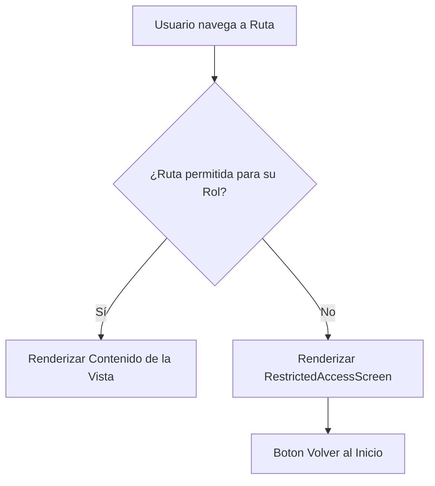

# Seguridad y Control de Acceso (MPAZ_PRO_6)

**Alcance:** Especificación de la arquitectura de autenticación, gestión de sesión persistente con DataStore Preferences y Control de Acceso Basado en Roles (RBAC) con Guards de Navegación en la aplicación Android.

---

## 1. Arquitectura de Autenticación

El proceso de autenticación valida las credenciales introducidas contra la base de datos local `MpazDatabase` (tabla `usuario`) o la API remota.

1. **Validación de Credenciales:**
   - Se consulta el usuario activo por `nombre_usuario`.
   - Se verifica que la cuenta esté activa (`activo = true`).
   - Se compara la contraseña provista con `passwordHash`.
2. **Protección de Credenciales en DTOs:**
   - La contraseña y `passwordHash` **nunca** son expuestos en `UsuarioResponse` ni en `UsuarioResumen`.
   - El DTO `UsuarioRequest` sobrescribe `toString()` para enmascarar `password='***'` en logs.

---

## 2. Gestión de Sesión Persistente (`SessionManager`)

Para evitar que la sesión del usuario se pierda al cerrar o reiniciar la aplicación, se implementa una capa de persistencia mediante **DataStore Preferences**.

- **Clase Encargada:** `com.ccstudio.mpaz_pro_6.data.local.preferences.SessionManager`
- **Archivo DataStore:** `mpaz_session.preferences_pb`

### Claves de Almacenamiento:
| Clave | Tipo | Descripción |
|---|---|---|
| `is_logged_in` | `Boolean` | Flag que indica si existe una sesión activa. |
| `user_id` | `Long` | ID del usuario autenticado (`usuario_id`). |
| `username` | `String` | Nombre del usuario logueado (`nombre_usuario`). |
| `user_rol` | `String` | Nombre del rol del usuario (`UTP`, `DOCENTE`, `ESTUDIANTE`). |

### Operaciones del Ciclo de Vida de Sesión:
- **`saveSession(userId, username, rol)`:** Guarda los datos del usuario en DataStore cuando el login es exitoso.
- **`clearSession()`:** Limpia todas las preferencias guardadas al cerrar sesión o al resetear la base de datos local.
- **`userSessionFlow`:** `Flow<UserSession?>` que emite cambios de estado en tiempo real hacia la UI a través de `LoginViewModel`.

---

## 3. Control de Acceso Basado en Roles (RBAC)

La interfaz y la navegación de la aplicación están restringidas según el rol del usuario autenticado.

### Matriz de Permisos por Rol (`NavDestination`):
| Vista / Ruta | UTP | DOCENTE | ESTUDIANTE |
|---|:---:|:---:|:---:|
| **Inicio** (`inicio`) | Sí | Sí | Sí |
| **Revisiones pendientes** (`revisiones_pendientes`) | Sí | No | No |
| **Cursos** (`cursos`) | Sí | Sí | No |
| **Docentes** (`docentes`) | Sí | No | No |
| **Usuarios** (`usuarios`) | Sí | No | No |
| **Asignaturas** (`asignaturas`) | No | Sí | Sí |
| **Crear** (`crear`) | No | Sí | No |
| **Informes** (`informes`) | No | Sí | No |
| **Actividades pendientes** (`actividades_pendientes`) | No | No | Sí |

---

## 4. Guard de Navegación (`ProtectedScreen` / Role Guard)

Para garantizar que un usuario no pueda acceder a rutas restringidas (por ejemplo, mediante navegación directa, deep links o manipulación de estado):

1. **Validación en `NavDestination`:**
   - La función `NavDestination.isRouteAllowedForRole(route, rol)` verifica si la ruta destino está incluida en la lista permitida para el rol del usuario logueado.
2. **Componente de Protección `ProtectedScreen`:**
   - Cada destino en el `NavHost` de `HomeScreen` está envuelto por el composable `ProtectedScreen`.
   - Si un usuario con rol `ESTUDIANTE` intenta acceder a la ruta `usuarios`, `ProtectedScreen` intercepta la navegación y renderiza `RestrictedAccessScreen` (Pantalla de Acceso Restringido con aviso de bloqueo y botón para volver al Inicio).

