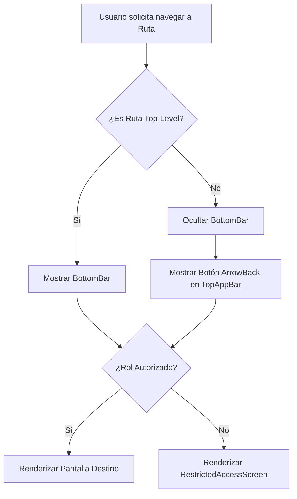

# Arquitectura de Navegación y Estructura de Vistas (MPAZ_PRO_6)

**Alcance:** Especificación de la estrategia de navegación, gestión dinámica de la cabecera (`TopAppBar`), visibilidad condicional del menú inferior (`NavigationBar`), patrones para vistas secundarias/detalle y reglas para agregar nuevas pantallas en la aplicación Android.

---

## 1. Clasificación de Destinos de Navegación

Las pantallas de la aplicación se dividen en dos categorías principales:

1. **Destinos Principales (Top-Level Destinations):**
   - Corresponden a los ítems visibles en la `BottomBar` según el rol autenticado (`UTP`, `DOCENTE`, `ESTUDIANTE`).
   - Ejemplos: `Inicio`, `Cursos`, `Asignaturas`, `Revisiones pendientes`, `Docentes`, `Usuarios`.
   - **Comportamiento:** Muestran la `BottomBar` y no llevan botón de retroceso (`<-`) en la cabecera.

2. **Destinos Secundarios o de Detalle (Sub-destinations):**
   - Vistas a las que se accede desde una vista principal o mediante un flujo de trabajo específico.
   - Ejemplos: `curso/{cursoId}`, `actividad/crear/{unidadId}`, `informe/{informeId}`, `evaluacion/responder/{actividadId}`.
   - **Comportamiento:** **Ocultan automáticamente la `BottomBar`** y muestran el botón de retroceso (`Icons.AutoMirrored.Filled.ArrowBack`) en la `TopAppBar`.

---

## 2. Gestión de la Cabecera (`TopAppBar`)

La cabecera (`TopAppBar`) se administra de forma centralizada en `HomeScreen` y se adapta dinámicamente según el estado de la navegación:

- **Título Dinámico:**
  - Para pantallas principales: Muestra el título asociado al ítem de menú activo.
  - Para pantallas de detalle: Muestra el nombre específico del recurso o el título de la vista secundaria (ej. *"Curso 6° A - Matemática"*).
- **Botón de Retroceso (Flecha Up / Back):**
  - Si la ruta actual es un destino secundario (`isTopLevel = false`), la `TopAppBar` muestra el icono de navegación `ArrowBack`, ejecutando `navController.navigateUp()`.
  - Si la ruta es un destino principal (`isTopLevel = true`), no se muestra botón de retroceso.
- **Acciones Contextuales (`actions`):**
  - Las vistas secundarias pueden inyectar acciones contextuales en la cabecera si lo requieren (ej. *Buscar*, *Filtros*, *Guardar Borrador*).

---

## 3. Gestión de la Barra Inferior (`NavigationBar` / BottomBar)

La visibilidad de la `BottomBar` se determina evaluando si la ruta actual pertenece a los destinos Top-Level autorizados para el rol activo:

```kotlin
val isTopLevelDestination = navItems.any { it.route == currentRoute }

Scaffold(
    bottomBar = {
        if (isTopLevelDestination) {
            NavigationBar {
                // Generación dinámica de ítems según rol
            }
        }
    }
)
```

---

## 4. Estructura Unificada de Destinos (`NavDestination`)

Toda pantalla agregada al proyecto debe registrarse en `NavDestination` especificando sus atributos clave:

```kotlin
sealed class NavDestination(
    val route: String,
    val title: String,
    val icon: ImageVector? = null,
    val isTopLevel: Boolean = false,
    val rolesPermitidos: List<String> = emptyList()
) {
    // --- DESTINOS PRINCIPALES (TOP-LEVEL) ---
    data object Inicio : NavDestination("inicio", "Inicio", Icons.Default.Home, isTopLevel = true, listOf("UTP", "DOCENTE", "ESTUDIANTE"))
    data object RevisionesPendientes : NavDestination("revisiones_pendientes", "Revisiones pendientes", Icons.AutoMirrored.Filled.FactCheck, isTopLevel = true, listOf("UTP"))
    data object Cursos : NavDestination("cursos", "Cursos", Icons.Default.School, isTopLevel = true, listOf("UTP", "DOCENTE"))
    data object Docentes : NavDestination("docentes", "Docentes", Icons.Default.Badge, isTopLevel = true, listOf("UTP"))
    data object Usuarios : NavDestination("usuarios", "Usuarios", Icons.Default.People, isTopLevel = true, listOf("UTP"))
    data object Asignaturas : NavDestination("asignaturas", "Asignaturas", Icons.Default.Book, isTopLevel = true, listOf("DOCENTE", "ESTUDIANTE"))
    data object Crear : NavDestination("crear", "Crear", Icons.Default.AddCircle, isTopLevel = true, listOf("DOCENTE"))
    data object Informes : NavDestination("informes", "Informes", Icons.Default.Assessment, isTopLevel = true, listOf("DOCENTE"))
    data object ActividadesPendientes : NavDestination("actividades_pendientes", "Actividades pendientes", Icons.Default.Task, isTopLevel = true, listOf("ESTUDIANTE"))

    // --- DESTINOS SECUNDARIOS / DETALLE ---
    data object DetalleUnidad : NavDestination("unidad_detalle/{unidadId}", "Detalle de Unidad", isTopLevel = false, listOf("UTP", "DOCENTE"))
    data object DetalleContenido : NavDestination("contenido_detalle/{contenidoId}", "Detalle de Contenido", isTopLevel = false, listOf("UTP", "DOCENTE", "ESTUDIANTE"))
    data object VistaPreviaActividad : NavDestination("actividad_vistaprevia/{actividadId}", "Vista Previa de Actividad", isTopLevel = false, listOf("UTP", "DOCENTE", "ESTUDIANTE"))
    data object DetalleCurso : NavDestination("curso_detalle/{cursoId}", "Detalle del Curso", isTopLevel = false, listOf("UTP", "DOCENTE"))
    data object DetalleAsignaturaCurso : NavDestination("curso_asignatura_detalle/{cursoId}/{asignaturaId}", "Detalle de Asignatura", isTopLevel = false, listOf("UTP", "DOCENTE"))
    data object DetalleDocente : NavDestination("docente_detalle/{docenteId}", "Detalle de Docente", isTopLevel = false, listOf("UTP"))
}
```

---

## 5. Integración con la Protección por Rol (RBAC & Guard)

Todas las rutas registradas en el `NavHost` deben ser evaluadas por el mecanismo de protección `ProtectedScreen`:

1. Al navegar a una ruta, `ProtectedScreen` consulta `NavDestination.isRouteAllowedForRole(route, rol)`.
2. Si el rol del usuario no está en `rolesPermitidos`, se intercepta el renderizado y se muestra `RestrictedAccessScreen`.

---

## 6. Diagrama del Flujo de Navegación


