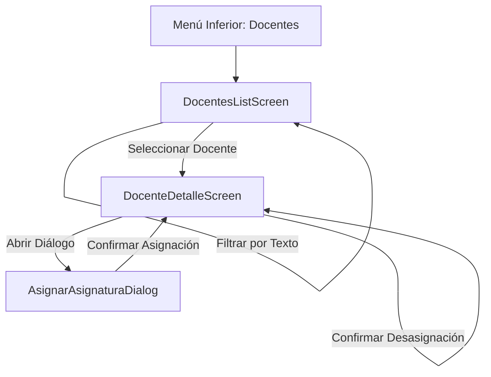

# Administración de Docentes y Asignaciones (MPAZ_PRO_6)

**Alcance:** Especificación funcional, de arquitectura y de datos para el módulo de administración de docentes encargados de asignaturas desde el rol UTP.

---

## 1. Visión General del Módulo

El módulo de administración de docentes permite a los usuarios con rol **UTP**:
1. Visualizar la lista completa de docentes registrados y activos en el sistema.
2. Filtrar docentes en tiempo real mediante un buscador por texto (por nombre, apellido o nombre de usuario).
3. Consultar las asignaturas y cursos actualmente a cargo de cada docente.
4. Acceder al detalle de un docente para gestionar (asignar y desasignar) las asignaturas en los distintos cursos. Un docente puede estar a cargo de múltiples asignaturas y cursos.

---

## 2. Flujo de Navegación y Vistas



1. **Lista de Docentes (`DocentesListScreen`):**
   - **Ruta:** `docentes` (Destino Principal Top-Level).
   - **Buscador:** Campo de texto `OutlinedTextField` que filtra en tiempo real sobre los campos `pnombre`, `apaterno`, `nombreCompleto` y `nombreUsuario`.
   - **Tarjeta de Docente (`DocenteCardItem`):** Muestra el nombre completo, usuario, chip de estado (`ACTIVO`/`INACTIVO`) y etiquetas (`SuggestionChip`) con las asignaturas y cursos asignados.

2. **Detalle de Docente (`DocenteDetalleScreen`):**
   - **Ruta:** `docente_detalle/{docenteId}` (Sub-destino secundario, `isTopLevel = false`).
   - **Cabecera:** Información general del docente.
   - **Lista de Asignaturas Asignadas:** Tarjetas con la asignatura y el curso correspondiente (`ej. Matemática - 6° A (2026)`), acompañadas del botón de desasignar.
   - **Diálogo de Asignación (`AsignarAsignaturaDialog`):** Permite buscar entre todas las combinaciones de `Asignatura` + `Curso` disponibles en la institución. Muestra si la asignatura está libre ("Sin docente asignado") o si actualmente pertenece a otro docente (permitiendo reasignación transparente).

---

## 3. Modelo de Datos y Consultas (`DocenciaDao`)

Las asignaciones se gestionan a través de la entidad intermedia `asignatura_curso` (que vincula `curso_id`, `asignatura_id` y `docente_id`) y la tabla puente de permisos `usuario_curso` (que vincula `usuario_id` y `curso_id`).

### Data Class de Consulta (`AsignaturaCursoDetalle`):
```kotlin
data class AsignaturaCursoDetalle(
    @Embedded val asignaturaCurso: AsignaturaCursoEntity,
    @Embedded(prefix = "asig_") val asignatura: AsignaturaEntity,
    @Embedded(prefix = "curso_") val curso: CursoEntity,
    @Embedded(prefix = "niv_") val nivel: NivelEntity,
    @Embedded(prefix = "sec_") val seccion: SeccionEntity,
    @Embedded(prefix = "doc_") val docente: UsuarioEntity?
) {
    val nombreCurso: String
        get() = "${nivel.nombre} ${seccion.letra}"

    val nombreCompletoCurso: String
        get() = "${nivel.nombre} ${seccion.letra} (${curso.annio})"
}
```

### Consultas SQL Principales (`DocenciaDao.kt`):
- **`getAsignaturasCursoByDocenteId(docenteId: Long)`:** Obtiene todas las asignaturas asignadas a un docente específico.
- **`getAllAsignaturasCursoDetalles()`:** Obtiene todas las asignaciones de asignatura-curso en la institución junto con la información detallada del curso, nivel, sección y docente a cargo.
- **`countAsignaturasByDocenteYCurso(docenteId: Long, cursoId: Long)`:** Cuenta cuántas asignaturas mantiene un docente en un curso específico para determinar si se debe remover el registro en `usuario_curso` al desasignar.

---

## 4. Reglas de Negocio para Asignación y Desasignación

1. **Asignación de Asignatura:**
   - Al asignar una asignatura en un curso a un docente, se ejecuta `UPDATE asignatura_curso SET docente_id = :docenteId WHERE curso_id = :cursoId AND asignatura_id = :asignaturaId`.
   - Se asegura que exista el registro correspondiente en `usuario_curso` (`usuario_id = docenteId, curso_id = cursoId`) para garantizar el acceso del docente al curso.

2. **Desasignación de Asignatura:**
   - Al quitar la asignatura a un docente, se ejecuta `UPDATE asignatura_curso SET docente_id = NULL WHERE curso_id = :cursoId AND asignatura_id = :asignaturaId`.
   - Se verifica si al docente le quedan otras asignaturas en ese mismo curso mediante `countAsignaturasByDocenteYCurso`. Si el conteo es `0`, se remueve la relación en `usuario_curso`.
