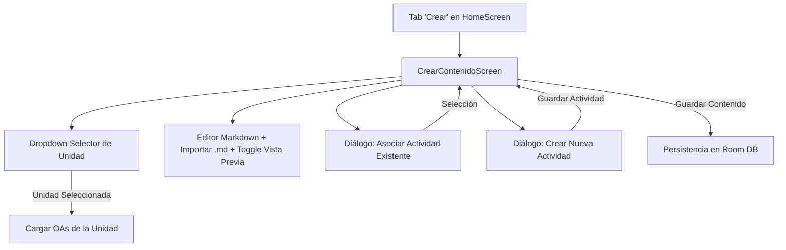

# Especificación Funcional y Técnica: Creación de Material Docente (Contenidos y Actividades)

**Alcance:** Flujo de creación de nuevos Contenidos y Actividades por parte del Docente desde la pestaña "Crear" (`NavDestination.Crear`).

---

## 1. Visión General

La vista **Crear** permite al docente generar nuevo material pedagógico (Contenidos y Actividades) de forma integrada:
1. **Selección de Unidad:** Elección de la Unidad académica correspondiente a sus asignaturas a cargo.
2. **Selección de OAs:** Selección múltiple de Objetivos de Aprendizaje asociados a la Unidad elegida.
3. **Editor de Contenido con Markdown:** Redacción de la descripción en Markdown, con opción de importar un archivo local (`.md` / `.txt`) y vista previa en tiempo real (`MarkdownRenderer`).
4. **Gestión de Actividades:**
   - **Asociar Actividades Existentes:** Diálogo con selector enriquecido que filtra actividades válidas (con `contenido_id` asignado), mostrando Tipo, Unidad original, total de preguntas y extracto de la primera pregunta (o `"sin preguntas"`).
   - **Crear Nueva Actividad:** Diálogo interactivo para definir Tipo de Actividad, Instrucciones y Preguntas con sus alternativas y respuesta correcta.

---

## 2. Flujo de UI y Navegación

---

## 3. Estrategia de Selección de Actividades Existentes (Sin Modificar BD)

Dado que `ActividadEntity` no posee un campo `titulo`, la UI construye un modelo enriquecido `ActividadSeleccionableItem`:
- **Filtro de validez:** Se excluyen actividades sin `contenido_id` (o `<= 0`).
- **Encabezado:** Tipo de Actividad (`ACTIVIDAD`, `DESAFÍO`, `PRUEBA FINAL`) + Chip de Estado.
- **Origen:** Nombre de la Unidad y Contenido padre original.
- **Detalle de Preguntas:**
  - Si `totalPreguntas > 0`: *"3 preguntas — P1: ¿Cuál es el propósito...?"*
  - Si `totalPreguntas == 0`: *"sin preguntas"*.

---

## 4. Estructura de Clases e Interacción de Componentes

1. **`CrearContenidoViewModel` (`ui/docente/CrearContenidoViewModel.kt`):**
   - Carga asignaturas y unidades del docente autenticado (`SessionManager`).
   - Carga OAs de la unidad elegida (`CurriculoDao.getObjetivosByUnidadId`).
   - Gestiona estado del formulario (`CrearContenidoUiState`).
   - Carga actividades seleccionables con detalles de preguntas.
   - Ejecuta la transacción de guardado completo en `Room` DB.

2. **`CrearContenidoScreen` (`ui/docente/CrearContenidoScreen.kt`):**
   - Componente Compose principal de la pestaña "Crear".
   - Incorpora lanzador de archivos para importar Markdown (`rememberLauncherForActivityResult`).
   - Diálogos integrados: `AsociarActividadDialog` y `CrearNuevaActividadDialog`.

3. **`HomeScreen` (`ui/home/HomeScreen.kt`):**
   - Reemplaza `GenericSectionScreen(title = NavDestination.Crear.title)` por `CrearContenidoScreen()`.
