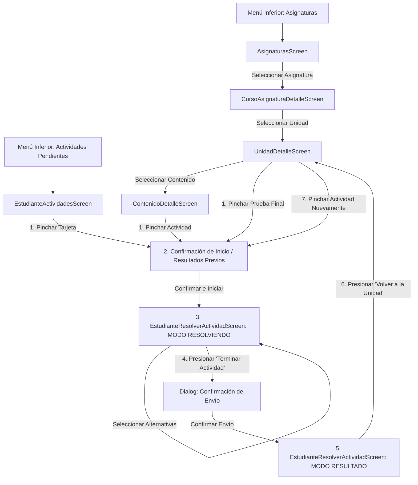

# Flujo del Estudiante y Evaluación de Actividades (MPAZ_PRO_6)

**Alcance:** Especificación funcional, de arquitectura, modelo de datos y componentes UI para el flujo del estudiante (alumno) en la plataforma MPAZ_PRO_6.

---

## 1. Visión General del Módulo

El flujo del estudiante permite a los usuarios con rol **ESTUDIANTE**:
1. **Acceder a las Asignaturas de su Curso:** Visualizar en la pestaña *Asignaturas* únicamente los ramos correspondientes al curso en el que se encuentra matriculado en la institución (`usuario_curso`).
2. **Navegación Pedagógica Multinivel:** Explorar el árbol curricular navegando desde Asignatura $\rightarrow$ Unidades $\rightarrow$ Contenidos $\rightarrow$ Actividades.
3. **Gestión de Actividades y Control de Intentos:**
   - Visualizar tarjetas de actividades con los intentos máximos permitidos (`maxIntentos`), la fecha de inicio y fin configuradas, y el número del intento a iniciar (ej. *Intento 1 de 4*).
   - Diálogo modal de confirmación antes de iniciar cualquier intento.
4. **Desarrollo de Actividades:** Selección interactiva de alternativas por pregunta.
5. **Confirmación al Finalizar:** Diálogo de alerta para confirmar el envío definitivo antes de registrar la evaluación.
6. **Desglose de Resultados y Feedback Pedagógico:**
   - Resumen del intento con número de respuestas correctas, incorrectas y porcentaje de logro.
   - Detalle de cada pregunta destacando la respuesta correcta en **verde** (`#E8F5E9` / `#2E7D32`) y, en caso de haber fallado, la opción elegida por el alumno resaltada en **rojo** (`#FFFFEBEE` / `#C62828`).
7. **Retorno Pedagógico:** Botón explícito *"Volver a la unidad"* para reincorporarse al estudio continuo.

---

## 2. Flujo de Navegación y Vistas (7 Pasos)



### Secuencia Detallada del Flujo:
1. **Selección de Actividad:** El estudiante selecciona una actividad desde `ContenidoDetalleScreen`, `UnidadDetalleScreen` o `EstudianteActividadesScreen`.
2. **Mensaje de Confirmación e Historial:** Aparece la pantalla/diálogo de confirmación. Si el estudiante ya realizó un intento previo, se visualizan los resultados del último intento (% de logro y correctas/incorrectas) junto con las opciones de iniciar un nuevo intento (si está permitido) o revisar respuestas anteriores.
3. **Desarrollo del Intento:** Al confirmar, se ingresa al modo `RESOLVIENDO` para responder las preguntas interactiva de la actividad.
4. **Finalización:** Presiona *"Terminar Actividad"* y confirma el envío en el diálogo modal.
5. **Vista de Resultados:** Se despliega la pantalla en modo `RESULTADO` con el porcentaje de logro obtenido y el desglose de preguntas resaltando las opciones correctas en verde e incorrectas en rojo.
6. **Retorno a la Unidad:** El estudiante presiona el botón *"Volver a la unidad"* (o botón de retroceso) para regresar al detalle del contenido/unidad.
7. **Reingreso / Nuevo Intento:** Al pinchar nuevamente en la actividad desde el detalle de la unidad o contenido, el mensaje de confirmación contiene los resultados del intento recién finalizado y ofrece la opción de realizar otro intento en el caso de que aún se encuentre dentro del límite permitido (`maxIntentos`).

---

## 3. Componentes y Capa de Presentación (UI)

### 3.1. `AsignaturasScreen` y `AsignaturasViewModel`
- **Ubicación:** `com.ccstudio.mpaz_pro_6.ui.screens`
- **Comportamiento:**
  - Identifica el rol del usuario en sesión (`ESTUDIANTE`).
  - Llama a `docenciaDao.getAsignaturasCursoByEstudianteId(userId)`.
  - Muestra la lista de asignaturas asignadas al curso del alumno, indicando el curso y el docente a cargo de la asignatura.

### 3.2. `EstudianteActividadesScreen`
- **Ubicación:** `com.ccstudio.mpaz_pro_6.ui.estudiante`
- **Ruta:** `actividades_pendientes`
- **Comportamiento:**
  - Consulta todas las actividades habilitadas y visibles del curso del estudiante (`getActividadesCursoConDetallesByEstudianteId`).
  - Muestra tarjetas de actividad (`ActividadCardEstudiante`) con la asignatura, unidad, instrucciones, fechas de vigencia e historia/resumen de intentos.
  - Incluye el diálogo de confirmación que muestra los resultados del último intento y permite iniciar el siguiente intento disponible o revisar las respuestas.

### 3.3. `EstudianteResolverActividadScreen`
- **Ubicación:** `com.ccstudio.mpaz_pro_6.ui.estudiante`
- **Ruta:** `actividad_resolver/{actividadId}?cursoId={cursoId}&intentoId={intentoId}`
- **Estados Internos (`EstadoResolverActividad`):**
  1. **`CONFIRMACION`:**
     - Despliega la tarjeta/pantalla de confirmación previa al inicio del intento.
     - Si existe un intento completado previo, visualiza el resultado del último intento (% de logro, respuestas correctas e incorrectas).
     - Presenta el botón *"Iniciar Intento X"* para comenzar el siguiente intento disponible y el botón *"Ver Respuestas Anteriores"* para consultar el detalle de respuestas.
  2. **`RESOLVIENDO`:**
     - Muestra el enunciado de cada pregunta y sus alternativas como RadioButtons / componentes seleccionables.
     - Muestra el número de intento (ej. *Intento 1 de 4*).
     - Muestra el botón *"Terminar Actividad (X de Y respondidas)"* que despliega el diálogo de confirmación de envío.
  3. **`RESULTADO`:**
     - Muestra la tarjeta resumen con el porcentaje de logro, respuestas correctas e incorrectas del intento enviado.
     - Desglosa cada pregunta mostrando la alternativa correcta en **verde** y la respuesta errónea seleccionada por el alumno en **rojo**.
     - Muestra **únicamente** el botón *"Volver a la unidad"* para retornar al árbol curricular.

---

## 4. Persistencia y Consultas de Datos

### 4.1. Entidades Involucradas (`EvaluacionEntities.kt` & `DocenciaEntities.kt`)
- **`IntentoEntity`:** Registra cada intento con `usuario_id`, `actividad_curso_id`, `fecha_inicio` y `fecha_fin`.
- **`RespuestaEntity`:** Almacena la combinación `intento_id`, `pregunta_id` y `alternativa_id`.
- **`ActividadCursoEntity`:** Almacena `max_intentos`, `fecha_inicio`, `fecha_fin`, `visible` y `habilitada`.

### 4.2. Consultas en DAOs (`DocenciaDao.kt` & `EvaluacionDao.kt`)
```kotlin
// DocenciaDao
@Query("SELECT ... FROM usuario_curso uc INNER JOIN asignatura_curso ac ... WHERE uc.usuario_id = :estudianteId")
suspend fun getAsignaturasCursoByEstudianteId(estudianteId: Long): List<AsignaturaCursoDetalle>

@androidx.room.Transaction
@Query("SELECT ac.* FROM actividad_curso ac INNER JOIN usuario_curso uc ... WHERE uc.usuario_id = :estudianteId AND ac.visible = 1 AND ac.habilitada = 1")
suspend fun getActividadesCursoConDetallesByEstudianteId(estudianteId: Long): List<ActividadCursoConDetalles>

// EvaluacionDao
@Insert(onConflict = OnConflictStrategy.REPLACE)
suspend fun insertIntento(entity: IntentoEntity): Long

@Insert(onConflict = OnConflictStrategy.REPLACE)
suspend fun insertRespuestas(entities: List<RespuestaEntity>): List<Long>
```

---

## 5. Reglas de Negocio y Estilos de Retroalimentación

1. **Confirmación Obligatoria al Iniciar:** No se permite iniciar un intento accidentalmente; requiere la confirmación explícita del alumno a través del diálogo modal.
2. **Confirmación Obligatoria al Finalizar:** Se requiere confirmación modal antes de registrar y cerrar el intento en la base de datos local.
3. **Registro de Duración:** `fecha_inicio` se guarda al abrir el intento y `fecha_fin` se establece con el timestamp exacto del momento de envío.
4. **Resaltado Visual de Errores (Requerimiento de Diseño):**
   - **Correcta:** Fondo verde `#E8F5E9`, borde `#2E7D32` e icono `CheckCircle`.
   - **Incorrecta seleccionada:** Fondo rojo `#FFFFEBEE`, borde `#C62828` e icono `Cancel`.

---

## 6. Reglas de Visibilidad y Ocultamiento de Estados para Estudiantes

1. **Ocultamiento de Estado de Unidades:**
   - En la tarjeta de lista de unidades (`UnidadItemCard` dentro de `CursoAsignaturaDetalleScreen`) y en el detalle de la unidad (`UnidadDetalleScreen`), no se despliega la etiqueta/chip con el estado de la unidad (ej. "Autorizado", "En revisión", "Borrador").
   - Se ocultan los paneles/banners de estado informativo y las acciones administrativas (como "Agregar Unidad").
2. **Filtrado Exclusivo de Unidades Autorizadas:**
   - El estudiante **únicamente** puede ver e interactuar con unidades que se encuentren en estado **AUTORIZADO** (`estado_id = 3`).
   - Las unidades en estado *Borrador* o *En revisión* son omitidas del listado de la asignatura (`loadAsignaturaDetail`).
   - Si un estudiante intenta ingresar directamente a una unidad no autorizada, se le muestra la pantalla/mensaje informativo indicando que la unidad no se encuentra disponible.
3. **Ocultamiento de Estado de Actividades:**
   - En las tarjetas de lista de actividades (`ActivityItemCard` en `ContenidoDetalleScreen`), no se muestra el chip del estado de la actividad (ej. "Publicado" / "AUTORIZADO").
   - En la vista de actividades pendientes del estudiante (`EstudianteActividadesScreen`), se filtran automáticamente las actividades pertenecientes a unidades no autorizadas.

